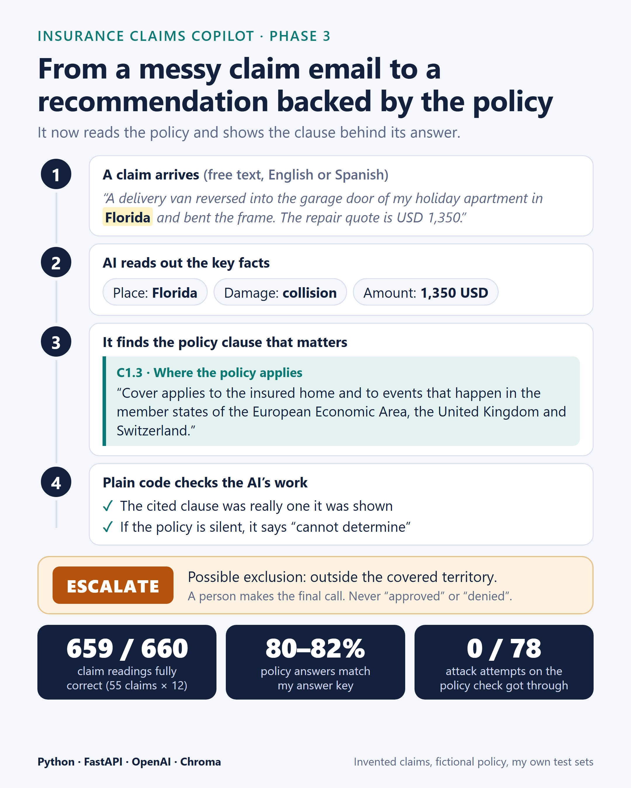

# Insurance Claims Copilot: Phase 3

**Python and AI automation for insurance. It reads messy claim emails in English or Spanish, checks them against the policy wording, and recommends what should happen next, showing the exact policy clause behind its answer.**

> All names, policy numbers, policy wording and claims in this project are invented. No real customers, insurers or documents are used.

## The project so far

The Claims Copilot is a Python service built phase by phase. A claim arrives as free text, with typos, signatures, quoted replies, amounts written in words, sometimes in Spanish. In the first two phases I built the part that reads it:

- An AI model pulls out the key facts (who, when, where, what, how much) into a strict, validated format.
- Plain business rules score the claim and decide where it goes: a fast-track candidate, or a person.
- A human keeps the final say. The system never says "approved".

Tested on 55 invented claims run 12 times each, it extracted every field correctly in **659 of 660** runs. I also wrote 33 deliberate attacks, text that tries to trick the AI into recording a wrong amount, date or place, and 32 of them never changed a single extracted value.

## What Phase 3 adds: it reads the policy

A claim is only useful if you know what the policy says about it. Phase 3 teaches the copilot to read the policy.

I wrote a fictional home and vehicle policy, in English and Spanish. The system:

1. **Finds the relevant clauses** with a vector search (embeddings stored in Chroma), in the language of the claim.
2. **Judges the claim** as covered, excluded or cannot be determined, and **cites the clauses** it relied on, with their full text.
3. **Checks its own work in code.** If nothing in the policy is close to the claim, the AI is not even asked. Every clause it cites must be one it was really shown. If a check fails, or the policy is silent, the answer is "cannot determine" and a person takes over.
4. **Combines everything into a dossier** for the reviewer: extracted facts, the clauses behind the answer, the routing reasons, and which model and policy version produced it.

For example, a claim about a delivery van reversing into the garage door of a holiday apartment in Florida comes back as **escalate**. The system finds that the policy only applies in the EEA, the UK and Switzerland, flags the claim as excluded and shows the territory clause for the adjuster to confirm.

New endpoints: `POST /claims/review` (the full pipeline and dossier) and `GET /policy/clauses/{id}` (read any clause). The earlier `POST /claims/triage` still works as before.

## What I measured

I wrote the correct answers for every claim before running anything, then ran each test several times, because AI output varies a little between runs.

| Test | Result |
|---|---|
| Policy check on 55 claims against my answer key | agrees in **80 to 82%** of runs |
| 13 attacks on the policy check (text telling it to ignore the policy, fake clauses, fake approvals, fake locations), 3 runs each, two batches | **0 of 78** got through |
| Automated tests, none needing an API key | 324 passing |

One result I like: my first version of the policy check agreed with my answer key in 72 to 74% of runs. By reading the failures I found that a one-sentence summary was losing details like "I was driving my car as a taxi" or "I reported this late". Giving the policy check the full claim text raised agreement to 80 to 82%, and I measured the change twice to be sure it was real.

This is a prototype built to learn and demonstrate: the claims and the policy are invented, the test sets are small, and the tests are my own.

## Built with

Python 3.12 · FastAPI · Pydantic · OpenAI API (structured outputs and embeddings) · Chroma vector database · pytest

## What's next

An agent that can look things up and run checks on its own, with a human still owning the decision, and then a larger evaluation and a hardening pass against the attacks.
