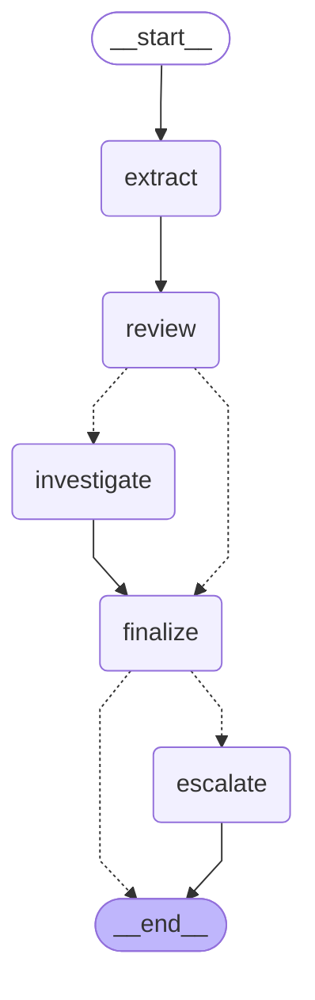
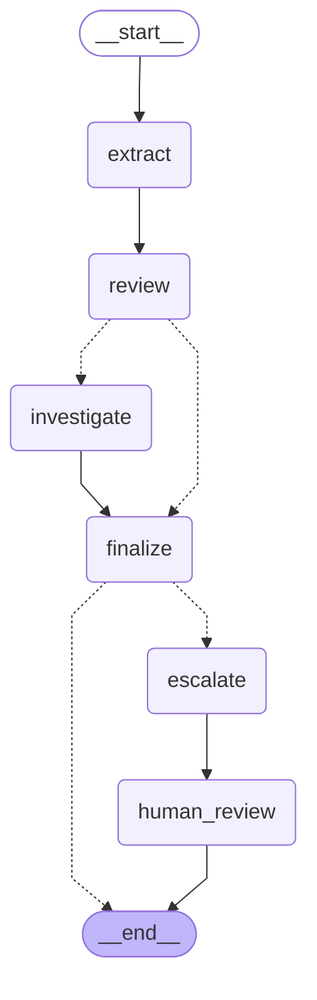

# The investigation flow as a LangGraph graph

Generated from `app/agent/graph.py` (`build_graph(...).get_graph().draw_mermaid()`), not drawn by hand. Dashed lines are the conditional edges: no documents skips `investigate`; only an escalated claim reaches `escalate`.

## The flow (what the tests compare with the hand-written version)

## With the pause for a person (`human_review=True`)

